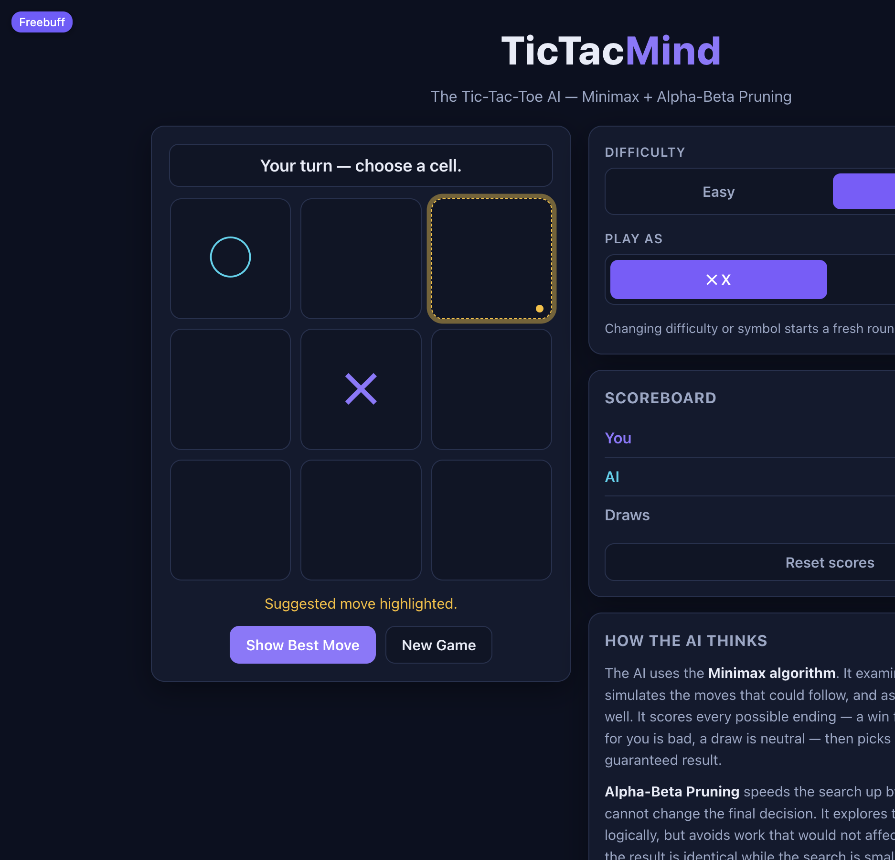

# TicTacMind — The Tic-Tac-Toe AI

A polished Tic-Tac-Toe game where you play against a computer opponent built
with the **Minimax algorithm** and **Alpha-Beta Pruning**. Everything runs
locally in the browser — no backend, no database, no API keys, no internet
required after the page loads.



## Features

- Human vs AI on a classic 3×3 board (you are always one symbol, the AI the other)
- **Unbeatable mode** — optimal Minimax search with Alpha-Beta Pruning. The
  computer cannot be forced to lose (it will win or draw, whatever you play)
- **Easy mode** — plays the optimal move about half the time and a random
  legal move otherwise, so it can be beaten
- **Show Best Move** — computes the optimal move *for you* with the same
  search (the AI's roles swapped) and highlights the cell
- Choose to play as **X or O** — choosing O makes the AI open, as X always
  starts
- Correct winner/draw detection with a winning-line highlight (colour **plus**
  a border and ✓ badge, so it does not rely on colour vision alone)
- Scoreboard (You / AI / Draws) with a two-step reset, persisted via
  localStorage and safe when storage is unavailable
- Live status messages and an "AI is thinking…" indicator
- Fully responsive (desktop, tablet, mobile) and keyboard accessible
- Flat, high-contrast theme (solid colours, bold borders, no gradients) that
  respects `prefers-reduced-motion`

## Project structure

```
src/
  components/
    GameBoard.tsx      # the 3x3 board, rendered from state
    GameCell.tsx       # one accessible cell button (hint / winning states)
    GameStatus.tsx     # live status line
    GameControls.tsx   # difficulty + symbol selectors
    ScoreBoard.tsx     # score counters + two-step reset
  logic/
    gameLogic.ts       # rules: board, winner, draw, legal moves, results
    minimax.ts         # Minimax, Minimax+Alpha-Beta, best move, hint
    difficulty.ts      # Easy vs Unbeatable move policy
    scores.ts          # validated localStorage persistence
    *.test.ts          # Vitest suites for the logic above
  App.tsx              # game loop, turn management, UI wiring
  main.tsx             # React entry point
  styles.css           # flat high-contrast theme, responsive layout
```

Game rules and the AI never touch React: they are plain functions over a
board array, which is why every algorithm can be unit-tested on its own.

## How the AI works

**Minimax** explores the game tree recursively. The AI is the *maximizing*
player and the human the *minimizing* player. Terminal positions are scored
with a depth-aware convention:

| Outcome      | Score       |
| ------------ | ----------- |
| AI wins      | `10 - depth`|
| Human wins   | `-10 + depth`|
| Draw         | `0`         |

Because deeper wins score less and deeper losses score less badly, the AI
prefers the fastest win and the slowest defeat.

**Alpha-Beta Pruning** carries two bounds through the search — `alpha` (the
best score the maximizer can guarantee so far) and `beta` (the best the
minimizer can guarantee). When `alpha >= beta`, the remaining siblings of that
node cannot influence any ancestor's decision, so they are skipped. The
resulting best move and score are identical to plain Minimax; only the amount
of search changes. `minimax.ts` contains both implementations side by side,
and a test asserts they always agree.

## Run it

```bash
npm install
npm run dev      # start the dev server (opens on localhost)
npm test         # run the Vitest suite
npm run build    # type-check and build the production bundle
npm run preview  # serve the production build locally
```

## Tests

`npm test` runs 31 tests covering winner/draw detection, move legality,
tactical AI decisions (take the win, block the loss), hint behaviour,
Easy-mode legality over hundreds of random boards, Alpha-Beta equivalence with
plain Minimax, and an **exhaustive search proving the Unbeatable AI cannot be
forced to lose with either symbol**.

## Tech

React 18, TypeScript, plain CSS, Vite, Vitest. No other runtime dependencies.
